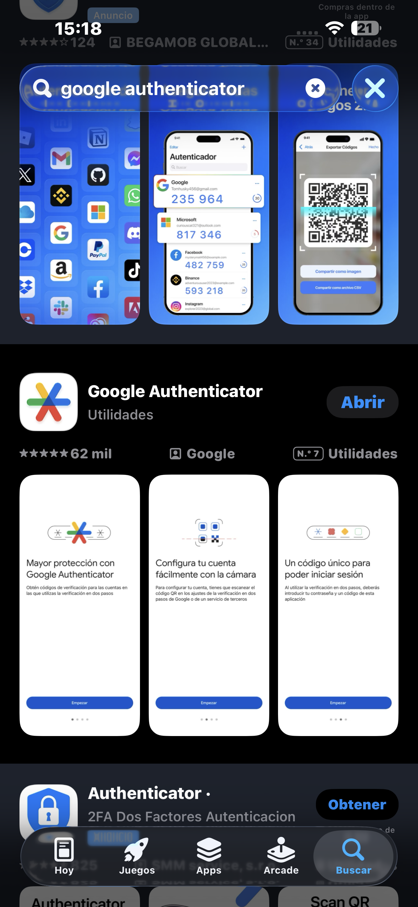
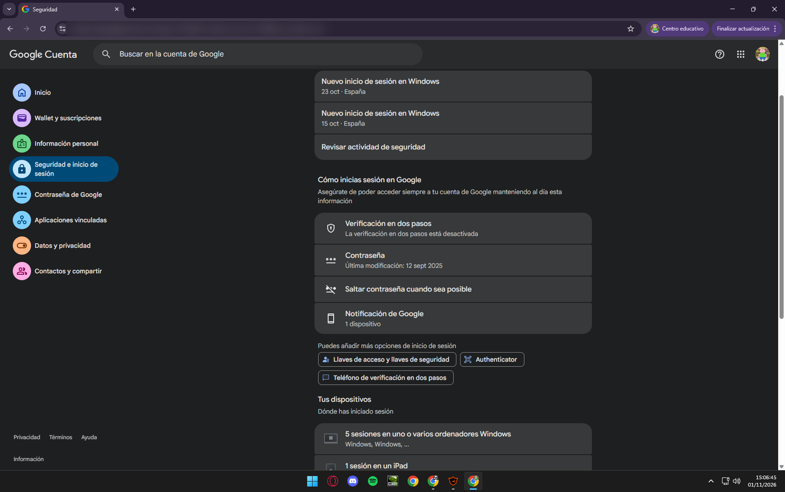
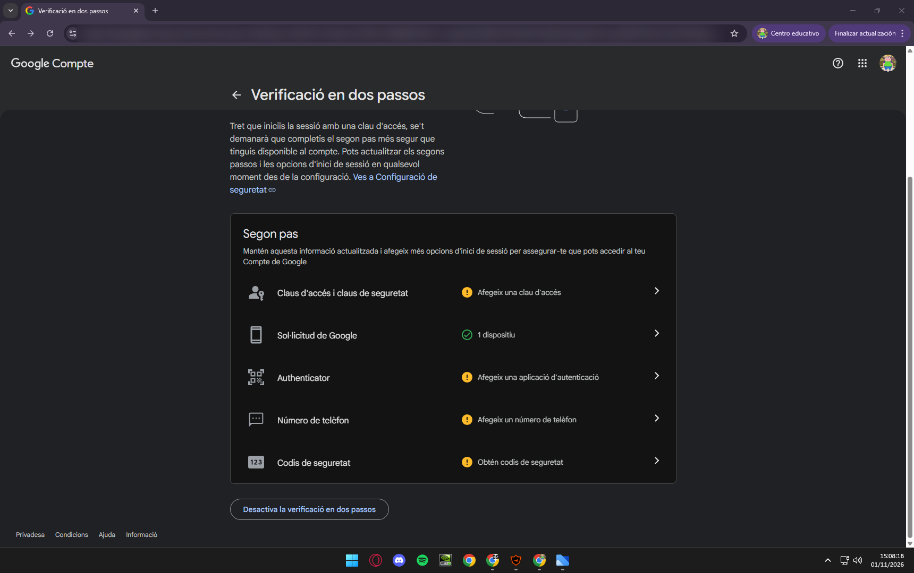
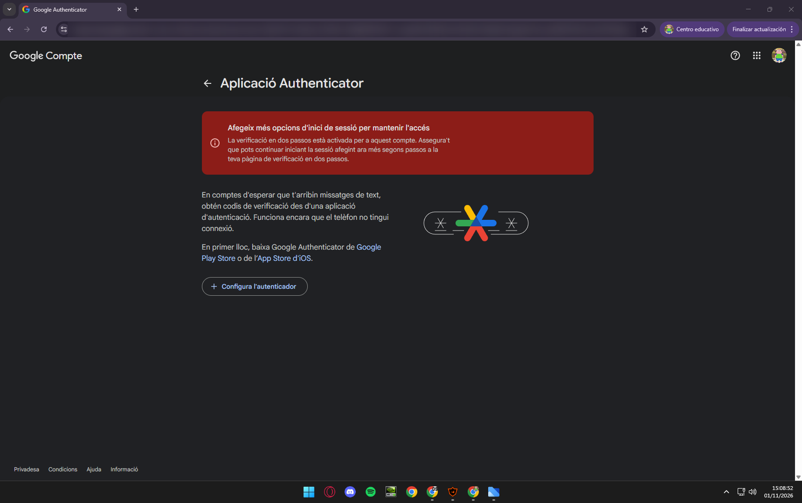
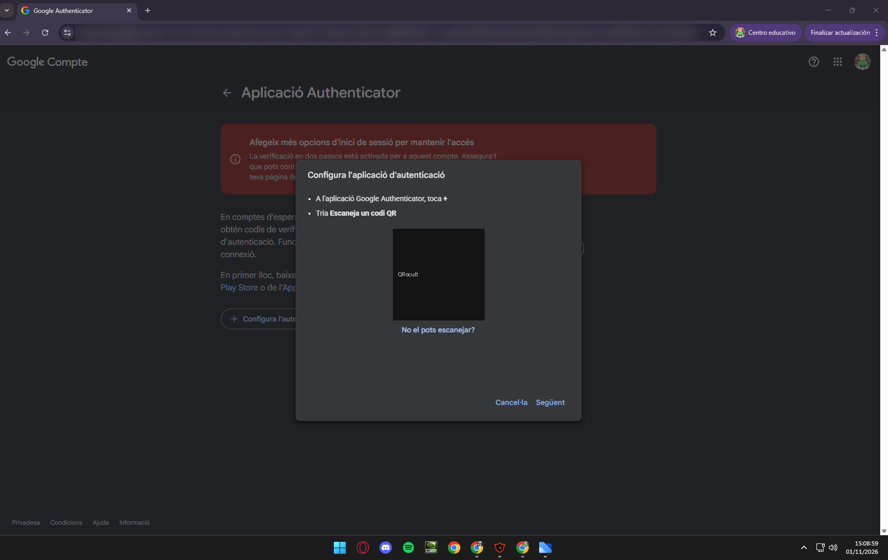
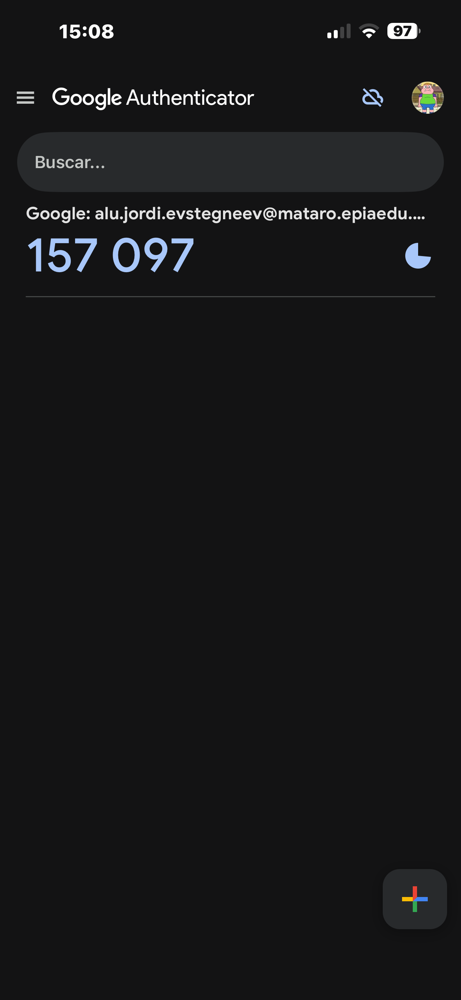
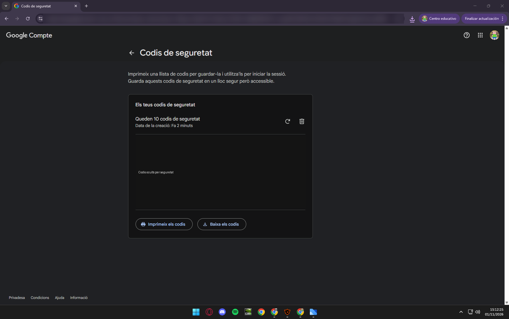
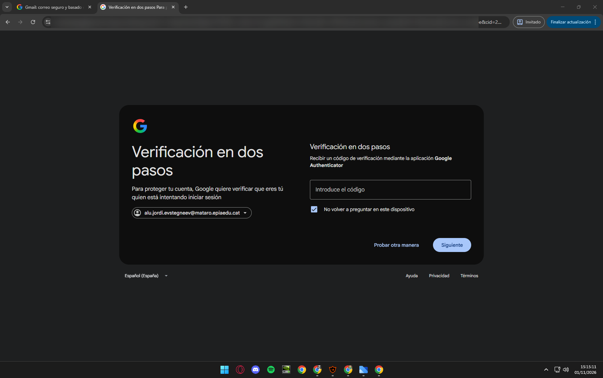

# Guia: activar l'autenticació multifactor (MFA) al compte de Google

**Activitat:** NF1AA3 – Autenticació multifactor (MFA)
**Mòdul:** 0226 Seguretat Informàtica
**Destinataris:** usuaris de l'organització amb compte `@mataro.epiaedu.cat`

---

## 1. Què és l'MFA i per què l'hem d'activar?

Quan entrem al compte només amb usuari i contrasenya, si algú ens roba la contrasenya (per phishing, una filtració o força bruta) ja pot entrar.

L'**autenticació multifactor (MFA)** demana **dues proves diferents** per entrar:

| Factor | Què és | Exemple |
|---|---|---|
| Una cosa que **saps** | Coneixement | Contrasenya, PIN |
| Una cosa que **tens** | Objecte físic | Mòbil, clau de seguretat |
| Una cosa que **ets** | Biometria | Empremta, cara |

És com el caixer automàtic: necessites la **targeta** (el que tens) i el **PIN** (el que saps). Encara que algú sàpiga la teva contrasenya, sense el teu mòbil no podrà entrar.

> ⚠️ **Per què no fem servir SMS?** Els codis per SMS es poden interceptar o robar amb tècniques com el *SIM swapping* (duplicar la teva targeta SIM). Una **app d'autenticació** genera els codis dins del mòbil, sense passar per la xarxa, i és molt més segura.

---

## 2. Què necessites

- Un ordinador amb connexió a Internet.
- Un smartphone Android o iOS.
- El teu compte de l'organització (`@mataro.epiaedu.cat`).
- Uns 10 minuts.

---

## 3. Pas a pas

### Pas 1 – Instal·la Google Authenticator al mòbil

1. Obre la **Play Store** (Android) o l'**App Store** (iOS).
2. Cerca **Google Authenticator** i instal·la-la.

> 💡 També funciona igual amb altres apps com Microsoft Authenticator o Authy.

---

### Pas 2 – Entra a la configuració de seguretat del compte

1. A l'ordinador, inicia sessió amb el teu compte de l'organització.
2. Ves a **Gestiona el teu compte de Google** → pestanya **Seguretat**.
3. Busca l'apartat **Inici de sessió a Google**.

---

### Pas 3 – Activa la verificació en dos passos

1. Fes clic a **Verificació en dos passos**.
2. Torna a posar la contrasenya si te la demana.
3. Segueix l'assistent: primer et farà **vincular el mòbil** al compte (és el mètode principal de Google).

---

### Pas 4 – Afegeix l'aplicació d'autenticació

1. Un cop activada la verificació, a la mateixa pàgina tria **Aplicació Authenticator**.
2. Fes clic a **Configura l'autenticador**. Apareixerà un **codi QR** a la pantalla.

3. Al mòbil, obre Google Authenticator → botó **+** → **Escaneja un codi QR**.
4. Apunta la càmera al QR de l'ordinador.

5. L'app mostrarà un **codi de 6 dígits**. Escriu-lo a l'ordinador i fes clic a **Verifica**.

> ⏱️ **Compte!** El codi canvia cada 30 segons. Si no et funciona, espera el següent i torna-ho a provar.

---

### Pas 5 – Genera els codis de seguretat de reserva (molt recomanat)

Si perds el mòbil o no tens cobertura, aquests codis et permetran entrar igualment.

1. A **Verificació en dos passos**, tria **Codis de seguretat**.
2. Google et genera **10 codis d'un sol ús**.
3. **Descarrega'ls o imprimeix-los** i guarda'ls en un lloc segur (per exemple, al gestor de contrasenyes). **No els deixis en un fitxer a l'escriptori.**

---

### Pas 6 – Comprova que funciona

1. Tanca la sessió i torna a iniciar-la.
2. Després de la contrasenya, Google et proposarà fer servir el mòbil. Fes clic a **Prova una altra manera**.
3. Tria **Obtén un codi de verificació de l'aplicació Google Authenticator**.
4. Escriu el codi de 6 dígits de l'app. Ja ets dins! ✅

---

## 4. Problemes habituals

| Problema | Solució |
|---|---|
| El codi diu que és incorrecte | Espera que canviï el codi. Revisa que l'hora del mòbil sigui automàtica. |
| He perdut o canviat de mòbil | Entra amb un **codi de reserva** i torna a configurar l'app al mòbil nou. |
| No tinc cobertura | L'app funciona **sense Internet**, els codis es generen al mòbil. |
| No tinc cap codi ni el mòbil | Contacta amb el **departament d'informàtica** de l'organització. |

---

## 5. Bones pràctiques

- Mantén activada la verificació en dos passos a **tots** els comptes importants.
- **No comparteixis mai** els codis de l'app ni els de reserva amb ningú (ni que diguin ser de suport tècnic).
- Si canvies de mòbil, **transfereix els comptes** des de l'app (opció *Transfereix comptes*) abans d'esborrar el mòbil vell.
- Fes servir una contrasenya forta i única, millor guardada en un gestor de contrasenyes.

---

## 6. Conclusió

Amb l'MFA, encara que algú aconsegueixi la teva contrasenya, no podrà entrar al compte sense el teu mòbil. És una mesura senzilla, gratuïta i que es configura en pocs minuts, però augmenta moltíssim la seguretat de la informació de l'organització.

---

**Font d'interès:** Kaspersky – *La autentificación de doble factor en SMS es insegura, ¿qué alternativas hay?*
